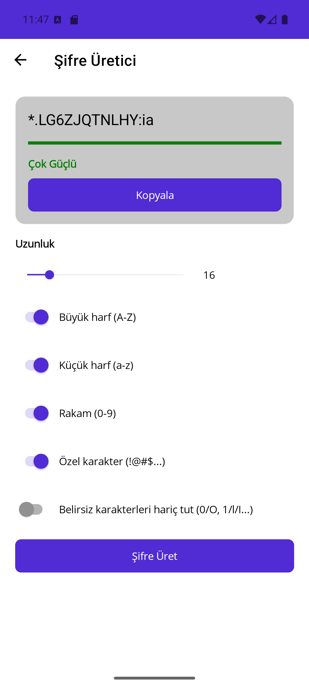
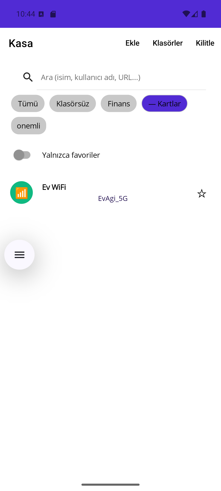

# KeyKeeper

**An offline-first, zero-knowledge password and data vault for Android, built with .NET MAUI.**

KeyKeeper keeps your logins, cards, Wi-Fi passwords, secure notes and software licenses in a single
encrypted vault that **never leaves your device**. There is no account, no cloud sync, no network
access and no telemetry. If you forget your master password, nobody (including the author) can
recover your data. That is the point.

<p>
  
  
  
</p>

## Download

Grab the signed APK from the [Releases page](../../releases/latest) and sideload it
(Android 6.0 / API 23 or newer). You may need to allow "Install unknown apps" for your browser or
file manager.

Verify the download against the SHA-256 checksum listed in the release notes before installing.

> KeyKeeper is not on the Play Store. Its `ApplicationId` is still the .NET MAUI template default
> (`com.companyname.keykeeper`); see [`ARCHITECTURE.md`](ARCHITECTURE.md), "Phase 11", for why it
> has deliberately not been changed yet.

## Features

**Vault**
- Five item types: **Logins**, **Cards**, **Wi-Fi networks**, **Secure notes**, **Software licenses**
- Nested **folders**, **tags** and **favorites**
- In-memory **search** (passwords and secrets are never indexed)

**Security**
- Master password is stretched with **Argon2id** (OWASP-recommended parameters)
- Vault is encrypted with **SQLCipher**; wrapped keys use **AES-256-GCM**
- **Biometric unlock** backed by the Android Keystore
- Escalating **lockout** after wrong attempts and automatic **lock on inactivity**
- Screenshots and app-switcher thumbnails are blocked (`FLAG_SECURE`)
- Root detection with a clear warning
- Android cloud backup and device-to-device transfer are disabled for the vault
- Sensitive buffers are zeroed after use

**Tools**
- **Password generator** and **strength analyzer**
- Built-in **TOTP** (two-factor code) generator
- **Clipboard auto-clear** after copying a secret
- **Android Autofill** service that offers saved logins in other apps, matched by domain

**Backup**
- Export and import an encrypted, versioned **`.vault`** file
- **CSV export** for migrating away (with a clear plaintext warning)

## Solution layout

- `KeyKeeper/` is the .NET MAUI app (`net10.0-android`, `net10.0-ios`)
- `KeyKeeper.Core/` is a plain `net10.0` class library: crypto, storage, auth, models, tools,
  security, backup. It has no MAUI, UI or platform references, and it is what
  `KeyKeeper.Core.Tests` exercises.
- `KeyKeeper.Core.Tests/` holds the xUnit tests for `KeyKeeper.Core`
- `docs/` holds the on-device verification screenshots and notes for each development phase

See [`ARCHITECTURE.md`](ARCHITECTURE.md) for the full phase-by-phase design history (crypto,
storage, auth, item types, organization/search, tools, security hardening, backup, UI polish,
release hardening) and the reasoning behind every non-obvious decision.

## Status

Android is the primary, verified target. The iOS head project compiles, but a full device or
simulator build needs Xcode on a Mac and has not been verified. iOS Autofill (a Credential
Provider Extension) is not implemented.

## Build from source

Prerequisites:

- .NET SDK with the `android` and `ios` workloads (`dotnet workload install android ios`)
- Android SDK and an emulator or device (API 23+). Building for `net10.0-ios` compiles the managed
  code, but a full app bundle needs Xcode on a Mac.

```
dotnet build KeyKeeper.Core/KeyKeeper.Core.csproj
dotnet build KeyKeeper/KeyKeeper.csproj -f net10.0-android
dotnet build KeyKeeper/KeyKeeper.csproj -f net10.0-ios
```

Run the tests:

```
dotnet test KeyKeeper.Core.Tests/KeyKeeper.Core.Tests.csproj
```

Run on an Android emulator or device:

```
dotnet build KeyKeeper/KeyKeeper.csproj -f net10.0-android -t:Run -p:AdbTarget="-s <device-serial>"
```

## Release build (Android)

Release builds enable R8 shrinking and obfuscation automatically (`KeyKeeper.csproj`,
Release-only). To produce a real signed APK or AAB you need your own release keystore. **Never
commit it or its password** (`keystore/` is gitignored for exactly this reason):

```
keytool -genkeypair -v -keystore keystore/keykeeper-release.jks -alias keykeeper \
  -keyalg RSA -keysize 2048 -validity 10000

dotnet publish KeyKeeper/KeyKeeper.csproj -c Release -f net10.0-android \
  -p:AndroidPackageFormat=apk \
  -p:AndroidKeyStore=true \
  -p:AndroidSigningKeyStore=<absolute path to your .jks> \
  -p:AndroidSigningKeyAlias=keykeeper \
  -p:AndroidSigningKeyPass=<password> \
  -p:AndroidSigningStorePass=<password>
```

Use `-p:AndroidPackageFormat=aab` instead of `apk` for a Play Store submission bundle. Always run
`apksigner verify --print-certs` on the result: a misconfigured build can silently fall back to a
debug certificate (details in `ARCHITECTURE.md`, "Phase 11").

## License

No license has been chosen yet, so all rights are reserved by default.
